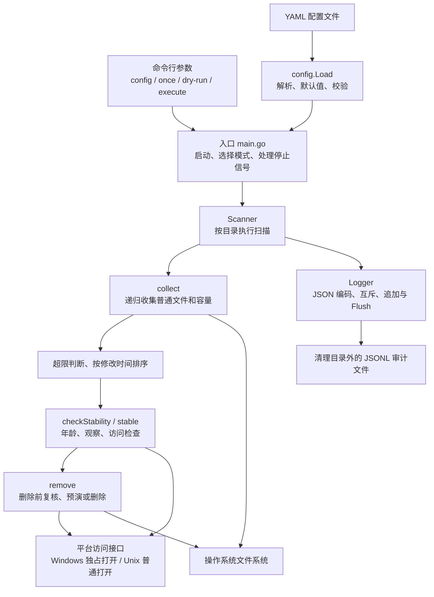
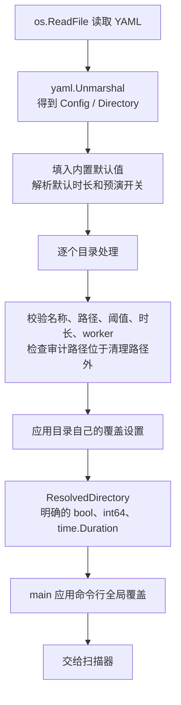
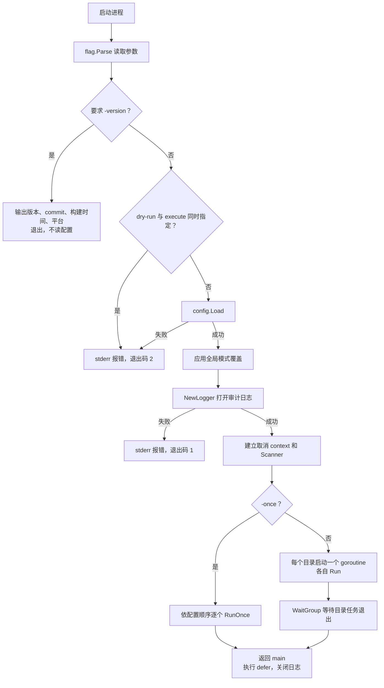
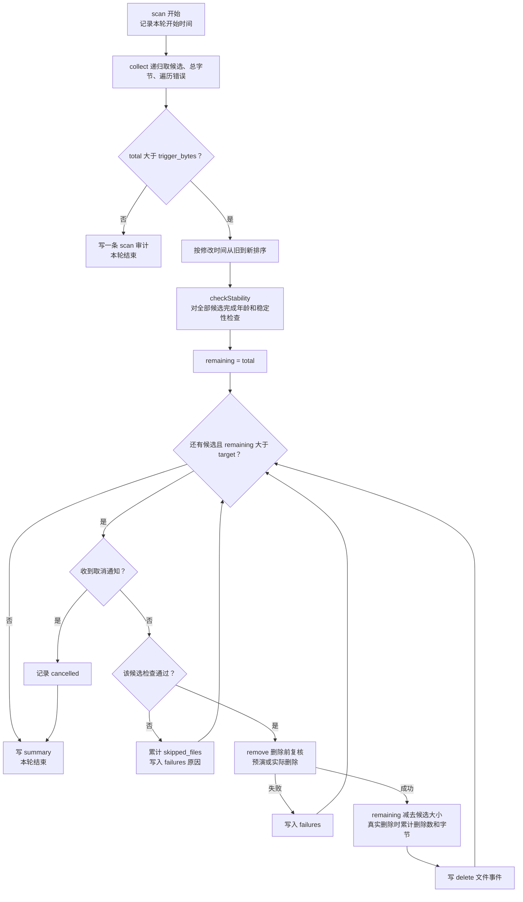
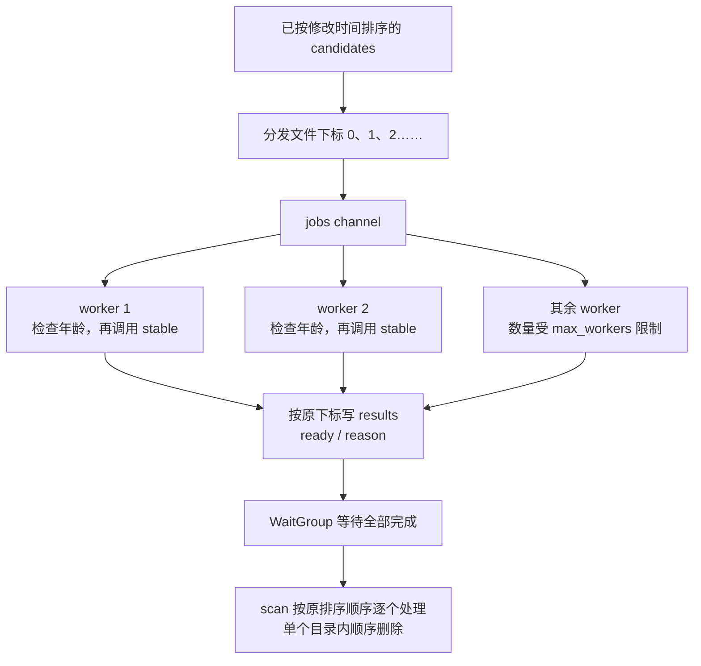
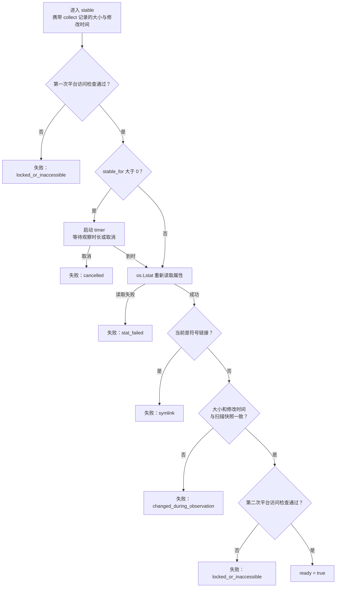
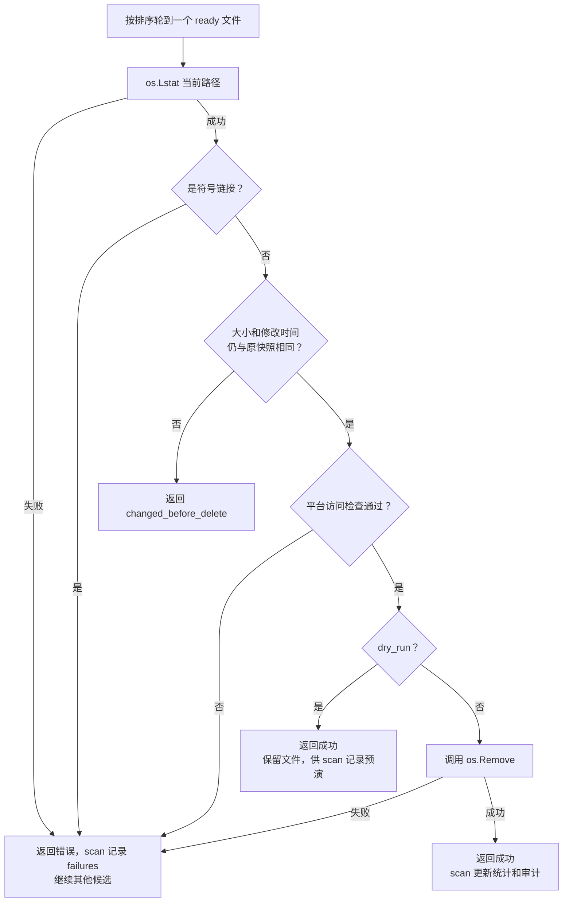
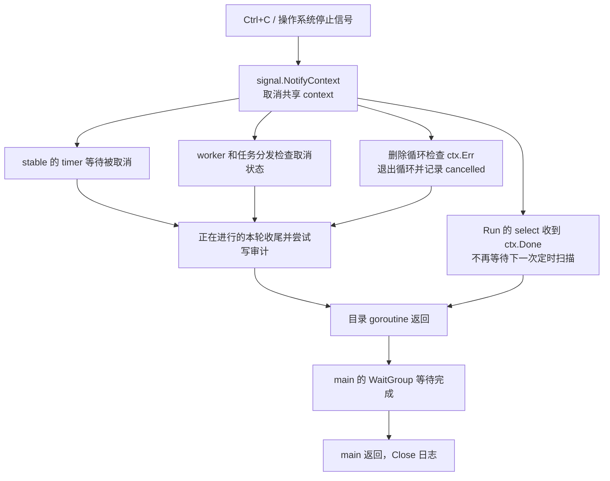

# Directory Cleaner 从零理解实现：文字与 Block Diagram 讲解报告

阅读对象：没有读过本项目源码，希望理解“程序为什么这样工作、每一步由谁完成、配置如何影响结果”的读者。

代码基线：2026-10-23，本报告按当前源码解释；教学例子会明确标注，不代表业务目录的实测数据。

建议分三遍阅读：第一遍看第 1～4 节，理解用途和结构；第二遍看第 5～13 节，跟踪一次扫描；第三遍看第 14～20 节，理解运行、验证、局限并动手练习。所有框图中的箭头表示调用、数据流或条件分支，具体含义由图中文字说明。

## 1. 先用一句话理解程序

**Directory Cleaner 定期统计指定目录及子目录中的普通文件大小；只有超过容量上限，才尝试从最旧的文件开始清理，并在每个文件删除前检查它是否足够旧、是否发生变化、是否能够访问。**

例如，一台设备不断产生扫描数据。你允许某个数据目录占用到 `100GB`，超限以后希望清理到 `80GB`。程序就把这两个值分别当作“开始清理的线”和“停止清理的线”。

它的工作对象是配置中列出的路径。每个路径分别计算容量、分别触发、分别完成清理。两个目录各占 `60GB`，各自上限都是 `100GB`，不会因为加起来有 `120GB` 而触发。

先记住四个事实：

1. 默认是 **dry-run（预演）**：检查并记录打算删除的文件，保留文件本身。
2. 排序依据是**最后修改时间**，越早修改的文件越先考虑。
3. 达到容量目标是努力方向；安全检查或权限问题可以让本轮无法达标。
4. 真正删除调用的是 `os.Remove`，代码没有实现回收站、备份或恢复功能。

## 2. 零基础需要掌握的词

| 名词 | 在本项目中是什么意思 | 一个直观例子 |
| --- | --- | --- |
| 程序 / 进程 | 硬盘上的可执行文件启动后成为运行中的进程 | `dircleaner.exe` 启动后持续扫描 |
| CLI | 通过命令行参数控制程序 | `-once` 表示只扫一轮 |
| 配置 | 告诉程序处理哪里、阈值是多少 | YAML 中的 `directories` |
| YAML | 便于人编辑的配置文本，依靠缩进表达层级 | `defaults:` 下的缩进行 |
| 普通文件 | 常见数据文件；代码不把目录、符号链接等作为候选 | `.csv`、`.png`、`.bin` 都可能被选中 |
| 递归扫描 | 进入目录的子目录，继续找文件 | `data/day1/a.csv` 也会统计 |
| 元数据 | 文件的属性，区别于文件内容 | 路径、字节数、修改时间 |
| 快照 | 在某次扫描时记录下来的状态 | 当时文件大小为 4 字节 |
| goroutine | Go 里可并发运行的一段任务 | 两个目录各有一个扫描任务 |
| channel | goroutine 之间传递任务的通道 | 把文件下标发给检查 worker |
| worker | 从任务通道取工作并处理的执行者 | 等待并复核一个文件是否稳定 |
| context | 用来传播“应当停止了”的取消通知 | Ctrl+C 后通知所有扫描任务 |
| Mutex | 互斥锁，让共享操作排队执行 | 防止同一进程的日志写入互相穿插 |
| WaitGroup | 等待一组并发任务全部结束 | 等待所有目录扫描任务退出 |
| JSONL | 每行都是一份独立 JSON 的日志格式 | 一条删除记录占一行 |
| 服务管理器 | 在系统后台托管、启动或重启程序 | Windows NSSM / Linux systemd |

这里的“稳定”有严格的代码含义：**再次看到的大小、修改时间与扫描快照一致，并且访问检查通过**。不要把这个词理解成对业务写入状态的完全证明。

## 3. 整体结构：谁负责什么

### 3.1 总体 Block Diagram



可以把程序看作一个小团队：入口负责接单和调度，配置模块把人类写的文本转换成明确规则，扫描器按规则判断，平台模块询问操作系统，日志模块记录发生了什么。

### 3.2 文件与职责对应表

| 位置 | 责任 | 阅读时先关注 |
| --- | --- | --- |
| [cmd/dircleaner/main.go](../cmd/dircleaner/main.go#L23) | 参数、初始化、扫描模式、信号和等待退出 | `main` |
| [internal/config/config.go](../internal/config/config.go#L80) | YAML、字节单位、继承、校验 | `Load`、`ByteSize.UnmarshalYAML` |
| [internal/cleaner/cleaner.go](../internal/cleaner/cleaner.go#L98) | 扫描、筛选、稳定性、删除、审计 | `scan`，再向下读调用函数 |
| [platform_windows.go](../internal/cleaner/platform_windows.go#L10) | Windows 访问检查 | `checkPlatformAccess` |
| [platform_unix.go](../internal/cleaner/platform_unix.go#L7) | 非 Windows 版本的访问检查；本项目主要验证 Linux | `checkPlatformAccess` |
| [配置示例](../directory-cleaner.yaml.example) | 可编辑的参数模板 | `defaults` 和 `directories` |
| [deploy/README.md](../deploy/README.md) | 发布包使用、服务安装、升级与回退 | 与目标平台对应的部分 |
| [docs/testing.md](testing.md) | 自动化检查与目标机器验收 | 能力跳过项和服务验收要求 |

项目没有图形界面、数据库或 HTTP 服务。运行时主要和配置文件、业务文件、审计文件及操作系统交互。`go.mod` 声明的直接第三方依赖是 YAML 解析库 `gopkg.in/yaml.v3 v3.0.1`，其余核心逻辑使用 Go 标准库。

## 4. 先把配置看懂

### 4.1 一份教学配置

下面只是说明语义的配置，不会由阅读报告自动执行：

```yaml
version: 1

defaults:
  scan_interval: 5m
  stable_for: 2m
  min_age: 10m
  max_workers: 1
  dry_run: true
  audit_log: logs/directory-cleaner.jsonl

directories:
  - name: scan-data
    path: E:/ExampleData/scans
    trigger_bytes: 100GB
    target_bytes: 80GB

  - name: csv-data
    path: E:/ExampleData/csv
    trigger_bytes: 20GB
    target_bytes: 15GB
    max_workers: 4
```

`defaults` 是公共设置；每个目录可以覆盖扫描间隔、稳定观察时长、最小年龄、worker 数和预演开关。示例中 `csv-data` 用 4 个 worker，`scan-data` 继承 1 个。

### 4.2 各字段的实际含义

| 字段 | 含义 | 省略时的处理 |
| --- | --- | --- |
| `version` | 配置格式版本，当前必须为 `1` | 省略会因版本为 0 而校验失败 |
| `directories` | 要处理的条目列表 | 至少一项 |
| `name` | 审计中使用的目录名称 | 第几项就生成 `directory-几`；名称不能重复 |
| `path` | 扫描根路径 | 必填；加载时不检查它一定存在且是目录 |
| `trigger_bytes` | 总量严格超过它才触发清理 | 必须大于 0，并大于目标值 |
| `target_bytes` | 剩余估算量小于等于它就停止 | 省略为 0，仍须满足校验关系 |
| `scan_interval` | 连续运行的定时触发间隔 | `5m` |
| `stable_for` | 每个候选文件的稳定观察等待时长 | `2m`；允许 `0s`，此时不等待 |
| `min_age` | 距离文件最后修改至少多久才可继续检查 | `10m`；允许 `0s` |
| `max_workers` | 每个目录并发执行稳定性检查的数量 | `1`；目录项为 0 时继承默认值 |
| `dry_run` | 是否只预演 | `true` |
| `audit_log` | 所有目录共用的审计文件 | 只在 `defaults` 中配置；默认 `logs/directory-cleaner.jsonl` |

注意容量后缀采用二进制倍数：`1KB = 1024` 字节，`1MB = 1024²` 字节，`1GB = 1024³` 字节。支持不带后缀的数字、大小写及小数，例如 `1.5 mb`；转换到整数时舍去不足 1 字节的部分。解析器拒绝负数、非法数字、非有限值以及超出 `int64` 上界的数值。当前没有实现 `GiB` 等额外后缀。

时长由 `time.ParseDuration` 解析，示例使用 `ms`、`s`、`m`、`h`；一天可写为 `24h`。`scan_interval` 必须为正；`stable_for` 和 `min_age` 可以为零，不能为负。

### 4.3 配置怎样从文字变成运行数据



程序使用两种配置结构是有原因的：原始结构保留“用户写了什么”，解析后的结构保存“程序最终应当执行什么”。例如原始配置的 `dry_run` 使用 `*bool` 指针：`nil` 表示没有填写、应当继承；非空指针可以明确表示用户写了 `false`。如果只用普通 `bool`，就难以区分“没有写”和“明确写 false”。

最终优先级：

```text
命令行 -dry-run / -execute
    高于 目录自己的设置
    高于 defaults 公共设置
    高于 代码内置默认值
```

`-dry-run` 与 `-execute` 不能一起使用。`-execute` 会把**所有配置条目**变为真实删除模式，并不只影响某一个目录。

### 4.4 配置路径有两个常见误解

第一，直接启动二进制时，相对路径根据**进程的当前工作目录**解释，不根据 YAML 文件所在目录解释。`-config X:/settings/config.yaml` 不会自动把业务路径切换到 `X:/settings`。发布包启动脚本先切换到包目录，因此包内启动的相对路径有固定起点；服务也设置了工作目录。

第二，加载配置会检查审计日志不能位于任何清理路径内部，但这是通过绝对化和路径相对关系进行的路径检查；并没有解析所有符号链接来证明磁盘上的物理位置。普通部署应使用明确的、不重叠的业务路径和日志路径。当前还没有拒绝不同配置条目使用相同或父子重叠路径。

当前 YAML 解析调用没有开启未知字段拒绝模式，所以拼错一个配置键不一定立刻报错；实际生效值仍取决于上述解析与默认规则。

## 5. 程序启动后，main 做了什么

源码入口：[main.go:23](../cmd/dircleaner/main.go#L23)。

### 5.1 启动 Block Diagram



### 5.2 参数逐个理解

| 参数 | 行为 |
| --- | --- |
| `-config` | 指定 YAML 路径，默认 `directory-cleaner.yaml` |
| `-once` | 每个配置条目扫描一次后结束；多条目顺序执行 |
| `-dry-run` | 强制所有条目预演 |
| `-execute` | 强制所有条目真实删除 |
| `-version` | 输出构建信息并结束，不要求配置存在 |
| `-h` | Go flag 提供的帮助 |

没有 `-once` 时是连续模式。入口创建一个共享的 `Scanner` 和一个共享的 `Logger`；每个目录有自己的扫描 goroutine。`Scanner` 本身只持有 logger，不在字段中保存目录的扫描快照，因此各轮的候选和统计值都在本轮局部变量中。

`defer logger.Close()` 可以理解成“离开 main 时再执行关闭”；`defer cancel()` 负责释放取消通知相关资源。`WaitGroup` 让 main 等待并发目录任务结束，避免启动任务后主函数立即返回。

运行中的单文件错误与启动错误走的是两条路径：启动错误打印到标准错误并使用非零退出码；扫描中的错误大多写入审计，不向 main 返回。因此退出码 0 不能单独证明每个文件都成功处理，必须结合审计判断。

## 6. 单轮扫描的完整路线

核心函数：[cleaner.go:98](../internal/cleaner/cleaner.go#L98)。先看图，再拆解。



等价的教学伪代码如下。它用于解释控制流，不是可直接替换源码的实现：

```text
收集文件和总量
如果 总量 <= 触发值：
    写 scan，结束

按修改时间排序
为全部候选完成稳定性检查
剩余估算量 = 总量

按排序后的顺序逐个处理：
    如果 剩余估算量 <= 目标值：停止
    如果 已取消：记录取消，停止
    如果 检查未通过：记录跳过，继续下一个
    如果 删除前复核或删除失败：记录失败，继续下一个
    剩余估算量 -= 此文件快照大小
    若为真实删除：累计删除字节和文件数
    写 delete

真实删除时更新 after_bytes
写 summary
```

一个关键实现顺序是：**先完成全部候选的稳定性检查，再开始有序处理文件**。即使最终只需要删两个文件，当前实现也会先检查其他候选。理解这一点，才能理解 `stable_for` 和 `max_workers` 对耗时的影响。

## 7. collect：容量到底是怎样算出来的

源码：[cleaner.go:188](../internal/cleaner/cleaner.go#L188)。

`collect` 使用 `filepath.WalkDir` 遍历配置路径及子目录。每看到一个普通文件，就取它的路径、大小和最后修改时间，生成一份候选记录，同时累加字节数。

假设目录是：

```text
data/
├── old.bin          4 字节
├── day1/
│   └── middle.csv   4 字节
├── new.png          4 字节
└── link             符号链接，跳过
```

结果是 3 个候选、合计 12 字节。子目录本身不作为删除候选，但仍会继续遍历子目录。代码没有按扩展名过滤，所以 `.bin`、`.csv`、`.png` 没有特殊待遇；普通隐藏文件也没有单独排除规则。

候选的基础数据结构是：

```go
type FileRecord struct {
    Path    string
    Size    int64
    ModTime time.Time
}
```

`[]fileCandidate` 是候选列表，`int64 total` 是累计字节，`[]string failures` 是遇到的问题。函数一次返回这三项，后续逻辑分别拿它们做排序、触发判断和审计。

这里统计的是普通文件的**逻辑大小之和**，不是整个磁盘的剩余空间，也不是文件系统实际分配的存储块数。它不按文件身份去重硬链接；稀疏文件、压缩和硬链接等情况会让“逻辑大小”与“实际可释放空间”产生差异。

遇到目录不可访问或读取属性失败时，当前代码把错误收集进 `failures` 并尽量继续遍历。此时总量可能只覆盖成功读取到的部分，程序也没有因“遍历不完整”而自动禁止后续清理。因此应把失败审计纳入判断，不能把一个数字当作完整磁盘盘点。

## 8. 为什么需要 trigger 和 target 两条线

源码对应 `scan` 中的两个判断：

```go
if total <= dir.TriggerBytes { /* 记录扫描并返回 */ }
if remaining <= dir.TargetBytes { /* 停止处理 */ }
```

所以准确边界是：

```text
开始条件：total > trigger_bytes
停止条件：remaining <= target_bytes
```

总量等于触发值时不清理；剩余量等于目标值时停止。

以触发 `100GB`、目标 `80GB` 为例：总量到 `100GB` 时还不会清理，超过才启动；一旦启动，就努力释放到 `80GB` 或更低，而不会只删到 `99.9GB`。两条线之间的缓冲区减少了“刚删完一点、又产生一点、又立刻触发”的情况，这通常称为滞回。

程序按整个文件删除，不能切掉文件的一部分。因此到达目标时可能低于目标值。例如当前 12 字节、目标 5 字节、每个文件 4 字节，删除两个后剩 4 字节，而不是恰好 5 字节。

目标不是硬性保证。文件太新、观察中变化、访问失败、删除失败或收到停止通知，都可能使本轮结束时仍然超目标。连续模式会在后续扫描重新评估，当前轮不会无限重试同一个文件。

## 9. 先删谁：按修改时间从旧到新

当前排序表达式是：

```go
sort.Slice(candidates, func(i, j int) bool {
    return candidates[i].ModTime.Before(candidates[j].ModTime)
})
```

`candidates[i]` 是列表中的第 i 项，`Before` 判断其时间是否更早。这个比较器告诉排序算法：修改时间越早，就排得越靠前。

它不读取文件名里的日期，不按创建时间、最后访问时间、文件大小或业务价值排序。如果业务程序把一个旧文件重新修改，它的优先级也会随修改时间改变。

修改时间完全相同的文件没有额外的明确排序规则。当前使用的不是稳定排序，也没有用路径作为第二排序键，因此不要依赖同时间文件的处理先后。

## 10. checkStability：并发到底发生在哪里

源码：[cleaner.go:149](../internal/cleaner/cleaner.go#L149)。

### 10.1 worker Block Diagram



任务通道里传的是下标，而不是另一份完整文件数据。worker 拿到下标后读取对应候选，并把检查结果写回 `results[index]`。不同 worker 处理不同下标，主流程在 `wg.Wait()` 返回后才读取这些结果。

这解决了一个问题：有些文件检查快，有些文件等待久，完成顺序可能不同；但结果仍与原候选一一对应，后续删除仍按修改时间顺序进行。检查先结束的较新文件不会因此插队先删。

`max_workers` 的作用范围是**一个目录的一轮稳定性检查**。实际 worker 数是配置值与候选数量两者中的较小值。

需要区分两层并发：

| 层级 | 连续模式 | `-once` 模式 |
| --- | --- | --- |
| 不同配置目录之间 | 每个目录一个 goroutine，可以同时运行和删除 | 按配置顺序逐个扫描 |
| 同一目录的稳定性检查 | 最多 `max_workers` 个并发检查 | 同样可以并发检查 |
| 同一目录的删除循环 | 顺序处理 | 顺序处理 |

所以两个目录各配置 4 个 worker，并不代表全进程最多 4 个；它们可能合计使用 8 个稳定性检查 worker。`max_workers` 也不负责限制遍历速度或并行删除数。

### 10.2 为什么稳定检查可能很慢

假设有 K 个文件都满足年龄并能进入观察，每个等待 S，worker 数为 W，忽略文件系统开销时，这个阶段大约需要：

```text
ceil(K / W) × S
```

`ceil` 表示向上取整。100 个文件、每个观察 `2m`、1 个 worker，大约等待 200 分钟；4 个 worker，大约 50 分钟。年龄不足或访问失败的文件可以较快返回，实际时间会受文件数量、错误、取消和系统开销影响。

这是根据代码顺序计算的教学估计，不是本次做过的性能基准。当前实现会检查全部候选，即使只需要删少量文件；把扫描间隔设成 5 分钟，也不能强迫一个耗时 50 分钟的扫描在 5 分钟内结束。

## 11. 一个文件怎样被判定可以删除

### 11.1 第一关：min_age

worker 先做：

```go
if time.Since(candidate.ModTime) < dir.MinAge {
    // 记录 too_young，跳过 stable
}
```

计算的是“当前时间减去最后修改时间”。例如 `min_age: 10m`，一个 2 分钟前修改的文件会被跳过；一个 1 小时前修改的文件才进入下一关。等于最小年龄时可继续。修改时间在未来的文件也通常会被这项检查挡住。

### 11.2 第二关：stable_for 观察与复核

源码：[cleaner.go:221](../internal/cleaner/cleaner.go#L221)。



这里有三个时间点：扫描记录快照、worker 完成观察、稍后删除前再次复核。代码没有每隔一秒持续采样，也不会检测到变化后自动重新计时；发现与快照不同就让本轮跳过。

`stable_for: 0s` 只去掉等待，不会去掉访问检查、`Lstat` 或大小与修改时间比较。稳定结果只存在本轮内存里；没有跨扫描保存“上轮已经稳定多久”的历史。

### 11.3 为什么 min_age 和 stable_for 同时存在

二者回答不同问题：

| 设置 | 回答的问题 | 能挡住什么 |
| --- | --- | --- |
| `min_age` | 距上次修改是否已经足够久？ | 刚生成、刚修改的文件 |
| `stable_for` | 等待一段时间后，属性是否仍与扫描快照相同？ | 扫描后仍发生明显变化的文件 |
| 删除前复核 | 轮到真正处理它时，属性是否仍相同？ | 稳定检查完成后又变化的文件 |

一个文件很老，也可能刚好又被某个程序打开；一个文件短时间没变，也可能只是写入进程暂停。因此代码叠加这些条件来降低误删风险，而不把任何单项当成绝对保证。

### 11.4 Windows 和 Linux 的检查差异

Windows 文件使用 `//go:build windows`，非 Windows 文件使用 `//go:build !windows`。Go 构建时选择对应版本，所以其他清理代码可以统一调用同名函数 `checkPlatformAccess`。

Windows 的实现调用 `syscall.CreateFile`，请求读取权限并把共享模式设为 0，尝试独占打开现有路径；成功后立即关闭句柄。普通文件存在共享冲突、无读权限或其他打开错误时，检查返回失败。

Linux 使用的实现是 `os.Open` 后立即关闭。它能检查当前账号是否可以这样打开文件，但普通打开成功并不能证明没有其他进程正在读写该文件。

两种实现都不会在整个观察阶段和删除阶段一直持有这个检查句柄。访问检查通过只是当时的检查结果；最终删除还可能因为权限或状态变化而失败。

## 12. remove：最后一道复核与真正删除

源码：[cleaner.go:249](../internal/cleaner/cleaner.go#L249)。



为什么 `stable` 之后还要检查一次？因为 worker 可能早已检查完这个文件，主流程仍在等待其他候选；从检查完成到轮到删除之间，文件可能再次变化。再做一次复核能发现其中一部分变化。

`Lstat` 与 `Stat` 的一个相关区别是：前者允许代码识别路径末端的符号链接本身，因此这里能够明确拒绝符号链接。

预演也会走这些复核。`remove` 在预演时返回的成功值表示“本次检查允许把它列入计划”，不是“已经删除”；真正的删除统计还要看 `dir.DryRun`。

复核与 `os.Remove` 是分开的调用，不构成一个原子事务。代码比较大小和修改时间，没有计算内容哈希或持续验证同一文件身份。因此它适合按约定清理已完成写入的数据，不能替代业务侧关于“文件已完成、允许删除”的明确协议。

## 13. 完整演算：三个文件是怎样变成一个文件的

### 13.1 初始条件

下面与仓库测试中的基本场景一致，是一个便于手算的教学例子：

| 文件 | 大小 | 最后修改 | 排序 |
| --- | --- | --- | --- |
| `old` | 4 字节 | 3 小时前 | 第 1 |
| `middle` | 4 字节 | 2 小时前 | 第 2 |
| `new` | 4 字节 | 1 小时前 | 第 3 |

设 `trigger_bytes: 10`、`target_bytes: 4`；年龄、稳定性和访问检查全部通过。

### 13.2 真实删除时

| 步骤 | 判断与动作 | `remaining` | 实际剩余文件 |
| --- | --- | --- | --- |
| 收集 | `4 + 4 + 4 = 12` | 12 | old、middle、new |
| 判断触发 | `12 > 10`，进入清理 | 12 | old、middle、new |
| 检查 | 全部候选完成稳定性检查 | 12 | old、middle、new |
| 处理 old | 删除成功，减 4 | 8 | middle、new |
| 下一次循环 | `8 > 4`，继续 | 8 | middle、new |
| 处理 middle | 删除成功，再减 4 | 4 | new |
| 下一次循环 | `4 <= 4`，停止 | 4 | new |

最终 summary：`before_bytes=12`，`after_bytes=4`，`deleted_bytes=8`，`deleted_files=2`。

### 13.3 预演时

预演也需要一个会递减的 `remaining`，否则程序就不知道“选几个文件才够”。但这个变量只用于模拟决策，文件没有真的减少。

| 步骤 | 计划 | 模拟 remaining | 实际容量 |
| --- | --- | --- | --- |
| 初始 | 无 | 12 | 12 |
| 预演 old | 若执行则减 4 | 8 | 12 |
| 预演 middle | 若执行再减 4 | 4 | 12 |
| 达标停止 | 不再计划 new | 4 | 12 |

因此预演 summary 必须是 `before_bytes=12`、`after_bytes=12`、`deleted_bytes=0`、`deleted_files=0`。这不是“程序没有选出文件”，而是审计在区分“计划”与“实际删除”。被选中的文件由两条 `action: delete` 且 `dry_run: true` 的文件事件表示。

默认配置已经是预演；命令行 `-dry-run` 的默认参数值虽然是 false，但没有指定该参数时并不会覆盖配置。代码只在用户明确选择 `-dry-run` 或 `-execute` 后应用全局覆盖。

### 13.4 如果最旧的文件过不了检查

假设 old 因访问冲突跳过，程序可以继续考虑 middle、new，并尝试用它们达到目标。所谓“旧文件优先”是按顺序**考虑符合条件的候选**，不是遇到一个旧文件不能删就停止全目录清理。

如果最后所有可处理文件都用完，剩余量还是高于目标，本轮仍会结束并写 summary；审计中的原因用来解释为什么没有达标。

## 14. 审计日志：怎样知道程序做了什么

### 14.1 JSONL 是什么

普通 JSON 文件可以包含一个很大的数组；JSONL 则把每个事件分别编码成 JSON，每行一条。读取时可以逐行处理，不需要等待整个日志形成一个完整数组。

本项目没有把每个候选逐条打印到控制台。成功运行时控制台可能很安静，主要证据在 `audit_log`。

`AuditEvent` 结构定义在 [cleaner.go:23](../internal/cleaner/cleaner.go#L23)。

| 字段 | 应怎样读 |
| --- | --- |
| `time` | 本轮扫描开始时间；本轮文件事件和 summary 沿用它 |
| `directory` | 配置目录的逻辑名称 |
| `path` | 该配置条目的扫描根路径 |
| `dry_run` | 本轮是否预演 |
| `before_bytes` | 本轮收集到的普通文件大小合计 |
| `after_bytes` | 预演保留初值；真实模式在 summary 中写入快照扣减的剩余估算量 |
| `deleted_bytes` | 本轮真实删除成功的快照字节总量 |
| `deleted_files` | 本轮真实删除成功的文件数 |
| `skipped_files` | 删除循环实际遇到的稳定性结果不通过数；不代表所有未删文件 |
| `failures` | 遍历问题、跳过原因、删除错误或取消等；没有时省略 |
| `action` | `scan`、`delete` 或 `summary` |
| `file` | 文件事件中的路径、大小、修改时间；没有时省略 |
| `reason` | 预演文件事件中为 `dry_run`；没有时省略 |

### 14.2 三类事件不是每轮都有

| 场景 | 事件序列 |
| --- | --- |
| 未超过触发值 | 一条 `scan` |
| 触发，预演选中两个文件 | 两条 `delete`，最后一条 `summary` |
| 触发，真实删除两个文件 | 两条 `delete`，最后一条 `summary` |
| 触发，但没有可处理的文件 | 一条含原因的 `summary` |

触发清理的轮次不会额外先写一个 `scan` 开始事件。`delete` 的语义需要结合 `dry_run` 判断，看到它不能直接认定文件已经被删除。

下面是“三个各 4 字节文件”预演结果的字段摘取示意；省略了时间和完整路径以便阅读：

```json
{"action":"delete","dry_run":true,"file":{"path":".../old","size":4},"reason":"dry_run"}
{"action":"delete","dry_run":true,"file":{"path":".../middle","size":4},"reason":"dry_run"}
{"action":"summary","dry_run":true,"before_bytes":12,"after_bytes":12,"deleted_bytes":0,"deleted_files":0,"skipped_files":0}
```

真实删除的 summary 教学示意则是：

```json
{"action":"summary","dry_run":false,"before_bytes":12,"after_bytes":4,"deleted_bytes":8,"deleted_files":2,"skipped_files":0}
```

这些摘取示意不是完整 `AuditEvent`，实际输出还包含上一表中的固定字段。

**判断一轮结果时以最后的 summary 为主。** 文件事件通过 `fileEvent := event` 复制当时的汇总状态，再设置文件与 action；复制发生在本文件计数更新之前，且 `after_bytes` 最后才更新。因此某条 `delete` 中的计数不是“删掉这一个后的最新总计”。

此外，真实模式的 `after_bytes` 来自“本轮初始总量减去成功删除的快照大小”，没有在结束时重新遍历。如果期间其他进程新增文件、修改文件或自行删除文件，这个值就可能与现场重新统计的大小不同。

### 14.3 failures 不只代表致命错误

| 常见文本 | 说明 |
| --- | --- |
| `too_young` | 文件距最后修改时间还不够久 |
| `changed_during_observation` | 等待后属性与扫描快照不同 |
| `changed_before_delete` | 轮到处理时属性已经变化 |
| `locked_or_inaccessible: ...` | 稳定性阶段的平台打开检查失败 |
| `stat_failed: ...` | 稳定性阶段重新读取文件属性失败 |
| `symlink` | 复核发现符号链接 |
| `cancelled` | 收到取消通知 |
| 其他系统错误文本 | 遍历、读取属性、平台访问或删除失败 |

`too_young` 是正常的保护性跳过，但代码也把它写在 `failures` 中。`remove` 返回错误时会记录失败，却不增加 `skipped_files`；达到目标后剩余候选没有进入删除循环，也不算 skipped。因此不能简单用“候选总数减去 deleted_files”推算 skipped。

### 14.4 日志怎样写到硬盘

`NewLogger` 先创建日志父目录，再以创建、追加、只写模式打开文件。`Write` 用互斥锁包住 JSON 编码和 `Flush`，使同一进程内的多个目录按完整记录写入同一个 logger。重启后追加，不主动清空旧记录。

`bufio.Writer` 是内存缓冲区，`json.Encoder.Encode` 负责编码并加换行，`Flush` 把缓冲交给底层文件写入。关闭时再 Flush 并关闭句柄。

需要知道当前实现的边界：初始化日志失败会阻止启动，但扫描器调用 `Write` 时用 `_ = ...` 丢弃返回错误，main 的延迟关闭也没有处理关闭错误。运行中发生日志写满或写入失败，不会自动中止删除；代码也没有调用 `Sync` 来承诺掉电持久性。互斥锁只协调当前 logger，不是跨进程锁。日志没有轮转和保留期限策略。

## 15. 连续运行、定时和优雅停止

### 15.1 Run 怎样周期执行

源码：[cleaner.go:83](../internal/cleaner/cleaner.go#L83)。

```text
建立 ticker
立即执行第一轮 scan
循环等待：
    收到取消通知 -> 退出
    收到 ticker 事件 -> 再执行一轮 scan
```

程序启动后先立即扫描，不会先空等一个 `scan_interval`。同一个目录的 `scan` 是同步调用，本轮没结束不会并发开启该目录的下一轮。

`ticker` 在第一轮扫描前创建，所以间隔不是“本轮结束后再完整等待 N 分钟”。如果扫描耗时长，定时事件可能被合并或丢弃，上一轮结束后也可能很快收到一个待处理事件；不会把每个错过的时点都变成无限堆积的扫描任务。

程序启动时只读取一次 YAML，没有配置文件热更新。更改配置后应通过受控重启使新值生效。

### 15.2 停止 Block Diagram



这是协作式取消：context 发出通知，各处主动检查并退出。它不会强行打断所有操作系统调用。`collect` 没有接收 context，正在进行的遍历也不主动检查取消；文件系统调用本身如果阻塞，也会影响停止延迟。

因此测试中验证的及时停止，是对测试环境和相应路径的验证，不能解释成任何磁盘、网络挂载、文件数量下都能在固定秒数内退出。`-once` 模式也使用 context，但目录仍按顺序调用；取消并不直接使 main 中的目录列表循环跳出。

## 16. 同一套清理逻辑怎样变成系统服务和发布包

### 16.1 业务逻辑与托管方式分开

前台命令行、Windows NSSM、Linux systemd 最终都运行同一个 CLI 入口。服务管理器负责进程生命周期，不替换内部扫描算法。

```text
Windows 服务控制管理器
    -> NSSM
        -> dircleaner.exe -config 配置路径
            -> main -> Scanner -> 文件系统 / 审计

Linux systemd
    -> dircleaner -config 配置路径
        -> main -> Scanner -> 文件系统 / 审计
```

Windows 安装脚本设置可执行文件、工作目录、自动启动、退出后的重启和 stdout/stderr 日志，并启动服务。默认服务名称是 `DirectoryCleaner`。服务账号的实际目录权限仍由部署环境决定。

Linux unit 设置专用 `directory-cleaner` 用户、工作目录、配置路径和 `Restart=on-failure`，失败后等待 10 秒再启动。`NoNewPrivileges=true`、`ProtectSystem=full` 等是服务运行限制；实际可写路径和账号权限必须与业务目录、日志目录匹配。

入口记录扫描问题后通常仍正常运行或退出，所以“文件删除失败”不会自然变成“服务进程崩溃”。服务管理器的崩溃恢复和审计中的业务失败需要分别观察。

### 16.2 为什么运行机器不必安装 Go

Go 是构建源码的工具链。发布包已经包含编译后的程序，目标机运行二进制不需要重新编译。发布脚本对三个打包目标关闭 CGO，检查依赖和二进制格式，并把 YAML 库等 Go 依赖编译进程序。

当前关系是：

| 范围 | 目标 |
| --- | --- |
| 发布包 | Windows amd64、Linux amd64、Linux arm64 |
| CI 交叉编译 | Windows/Linux × amd64/arm64 四种组合 |
| 原生自动运行验证 | Windows Server 2022、Ubuntu 22.04/24.04 的 amd64 作业 |
| Go 兼容性 | 常规源码最低 Go 1.21；当前主测试/发布工具链固定 Go 1.25.12，CI 另有 Go 1.21.13 作业 |

“能够交叉编译”只说明能生成对应平台文件，不能证明已在那种 CPU 和系统上实际运行，尤其不能把 ARM64 结构检查当作 ARM64 运行验收。

发布脚本通过链接参数填写 `main.version`、`main.commit`、`main.buildTime`。普通开发构建保留默认的 `dev / unknown / unknown`；`-version` 只是读取这些编译时信息，不向外部服务器查询版本。

### 16.3 测试和发布链条

[GitHub Actions 配置](../.github/workflows/test.yml) 定义：原生测试、Ubuntu 竞态检查、发布包构建与验证、真实 NSSM/systemd 服务验收、四组合交叉编译，以及汇总门禁 `CI`。标签发布依赖同次运行的门禁通过，并使用该次测试产生的包。

服务验收脚本使用唯一临时服务名、可丢弃数据和自动清理；检查安装、启停、重启、崩溃恢复、停止后审计不再增长、取消时最后审计写出、真实删除和卸载。服务验收缺少管理员/root 或实际服务管理器时应失败，不用跳过掩盖。

这里是在解释仓库配置的检查链，并不表示本次已访问远端 CI 或运行过这些服务验收。升级时保留现场 YAML、业务数据和日志的具体操作见部署文档；本次只生成讲解资料，不执行部署。

## 17. 十个容易误解的问题

**问题 1：扫描间隔到了就一定马上清理吗？**

不一定。先要轮到该目录扫描，总量还要严格超过触发值，文件还要通过年龄、稳定性、访问和删除前复核；耗时较长的上一轮也会推迟下一轮。

**问题 2：文件在这个目录里很久，为什么仍被认为太新？**

年龄依据最后修改时间。昨天创建、刚刚又修改的文件，修改年龄仍可能只有几秒。

**问题 3：检查了稳定性，是否保证不删正在使用的文件？**

不能做这种保证。Linux 普通打开不能识别所有占用情况；两种平台的检查句柄都会关闭，属性比较和最终删除也不是原子操作。

**问题 4：预演为什么也要等 stable_for？**

预演复用实际筛选路径，仍需判断当前哪些文件能进入计划。它只跳过最终 `os.Remove`，没有跳过前面的检查。

**问题 5：日志说 delete，文件为什么还在？**

先看 `dry_run` 和 `reason`。预演文件事件同样使用 `action: delete`，但实际删除计数为零。

**问题 6：max_workers 越大是不是删得越乱？**

它增加稳定性检查的并发数；结果按下标保存，单个目录内仍按排序顺序处理。不同目录之间可以并发运行。

**问题 7：已降到 target，为什么系统看见的大小仍更大？**

summary 是扫描快照扣减，并未复扫；期间可能有新增数据。系统显示的还可能是分配空间等不同统计口径。

**问题 8：清理完会删除空目录吗？**

当前候选来自普通文件，代码没有专门删除空目录的流程。不要把它当成目录树整理器。

**问题 9：可以只删 CSV 或只保留最近 N 天吗？**

当前配置没有后缀过滤和“到期就删”策略。年龄只是超容量清理时的保护条件；容量没超触发值，文件再老也不会因此单独被删除。

**问题 10：程序退出成功，是否代表没有任何清理或审计问题？**

不是。扫描错误主要留在日志；运行中的日志写入错误当前还会被调用者忽略。应检查 summary、failures 和日志是否持续产生，不能仅看进程退出码或服务 Running。

## 18. 对照源码时需要的少量 Go 语法

无需先学完整门语言，先理解以下几种写法就能读懂本项目主流程：

| 写法 | 这里怎样理解 |
| --- | --- |
| `package main` / `func main()` | 可执行程序的入口包与入口函数 |
| `import (...)` | 引入标准库或其他包 |
| `type X struct { ... }` | 定义一组有名字的字段，例如文件记录 |
| `[]fileCandidate` | 一个可变长度的文件候选列表，Go 称切片 |
| `*Logger` / `*bool` | 指向值的指针；后者也能表示“没有填写” |
| `func (s *Scanner) scan(...)` | 属于 Scanner 的方法，通过 s 使用它的字段 |
| `value, err := function()` | 函数返回结果与错误，并创建局部变量 |
| `if err != nil` | 出错就进入这个分支；没有错误时 err 为 nil |
| `return false, "reason"` | 一次返回布尔值和原因字符串 |
| `go func() { ... }()` | 启动一个并发任务 |
| `jobs <- index` | 把下标发送到任务通道 |
| `for index := range jobs` | 持续接收通道任务，通道关闭且任务用完后结束 |
| `select { ... }` | 等待多个通道事件中的一个，例如定时或取消 |
| `defer ...` | 当前函数退出时执行收尾操作 |
| `_ = function()` | 调用但丢弃返回值；这里尤其要注意日志错误被丢弃 |
| 字段后的 `yaml:"dry_run"` | 指定配置文本使用的字段名 |
| `json:"failures,omitempty"` | 指定 JSON 键，空值时省略该字段 |

推荐阅读顺序是 `main -> config.Load -> scan -> collect -> checkStability -> stable -> remove -> Logger.Write`。先理解一个正常例子，再看每个错误分支；先确认每个函数的输入和输出，再看内部细节。

这些函数可以概括成一条数据链：

```text
YAML 文本
    -> 明确的目录规则 ResolvedDirectory
    -> 候选列表、总容量、遍历错误
    -> 有序候选及一一对应的稳定性结果
    -> 删除/预演结果与汇总计数
    -> JSONL 事件
```

## 19. 动手练习：只在新建教学目录中预演

本节让你自己看到“配置 -> 扫描 -> 计划 -> 审计”的全过程。练习只创建专用教学文件并运行 `-dry-run`，没有安排真实删除或服务安装。代码假设已经安装 Go，并在仓库根目录使用 PowerShell 执行。

### 19.1 编译并创建三个测试文件

```powershell
# 从源码构建教学用二进制。
New-Item -ItemType Directory -Force -Path artifacts | Out-Null
go build -o artifacts/lesson-dircleaner.exe ./cmd/dircleaner
if ($LASTEXITCODE -ne 0) { throw '构建失败' }

# 唯一目录名避免覆盖已有数据；只在该目录里建立教学文件。
$lessonRoot = Join-Path (Get-Location) ('artifacts/lesson-' + [Guid]::NewGuid().ToString('N'))
$lessonData = Join-Path $lessonRoot 'data'
New-Item -ItemType Directory -Path $lessonData -Force | Out-Null
$lessonNames = @('old', 'middle', 'new')
for ($i = 0; $i -lt $lessonNames.Count; $i++) {
    $lessonFile = Join-Path $lessonData $lessonNames[$i]
    [IO.File]::WriteAllText($lessonFile, '1234', [Text.Encoding]::ASCII)
    (Get-Item -LiteralPath $lessonFile).LastWriteTime = (Get-Date).AddHours(-3 + $i)
}
```

`ASCII` 在这里使 `1234` 恰好是 4 字节。三个文件分别设为约 3、2、1 小时前修改，让优先级清楚可见。练习目录采用随机唯一名称，不需要触碰任何业务目录。

### 19.2 生成本次练习专用配置

接着在同一个 PowerShell 会话执行，沿用上一步的变量：

```powershell
$lessonAudit = Join-Path $lessonRoot 'audit.jsonl'
$lessonConfig = Join-Path $lessonRoot 'config.yaml'
$lessonYaml = @"
version: 1
defaults:
  audit_log: '$($lessonAudit.Replace('\', '/'))'
  min_age: 10m
  stable_for: 0s
  max_workers: 2
  dry_run: true
directories:
  - name: lesson
    path: '$($lessonData.Replace('\', '/'))'
    trigger_bytes: 10
    target_bytes: 4
"@
[IO.File]::WriteAllText($lessonConfig, $lessonYaml, [Text.UTF8Encoding]::new($false))
```

日志是 `lessonRoot/audit.jsonl`，清理对象是其下的 `lessonRoot/data`，所以日志在清理目录外。只把教学配置中的 `stable_for` 设为 `0s` 是为了立即看到结果；生产设置需要结合实际文件写入周期选择。

### 19.3 运行并读结果

```powershell
& ./artifacts/lesson-dircleaner.exe -config $lessonConfig -once -dry-run
if ($LASTEXITCODE -ne 0) { throw '预演启动失败' }

Get-Content -LiteralPath $lessonAudit
Get-ChildItem -LiteralPath $lessonData -File | Select-Object Name, Length
```

你应看到两条预演 `delete`，依次对应 old 和 middle，最后一条 summary 的 `before_bytes` 与 `after_bytes` 都是 12，`deleted_files` 为 0；三个数据文件都还在。

可以在保持预演的前提下，用下面三个变化检验理解：

| 改动 | 运行前先预测 | 正常情况下预期结果 |
| --- | --- | --- |
| 把 `trigger_bytes` 改为 12 | 等于触发值要不要清理？ | 不触发，新增一条 `scan` |
| 保持触发 10，把 `target_bytes` 改为 8 | 需要计划几个文件？ | 只计划 old，模拟到 8 即停止 |
| 把 `min_age` 改为 `24h`，触发仍 10 | 有哪些候选够老？ | 三个都太新；summary 删除为 0，包含 `too_young` |

同一日志每次运行会追加记录，所以观察新一轮时要看末尾的事件。修改 YAML 后重新运行一次，程序才会重新读取。

### 19.4 五个自测题

1. 总容量 10、触发值 10、目标值 4，会清理吗？
2. `-once` 有两个目录，每个目录 `max_workers: 4`，目录本身会同时开始吗？
3. 预演的模拟剩余量降为 4，summary 的实际 `after_bytes` 是否也应写 4？
4. 某文件稳定检查后又改变大小，删除前能发现吗？
5. Linux 上 `os.Open` 成功，能否证明没有其他程序正在写入？

答案：1 不会，必须严格大于触发值；2 不会，目录顺序执行，但每个目录内部检查可并发；3 不应，预演保留实际初始量；4 复核比较原快照，能发现这个大小变化并拒绝；5 不能。

## 20. 本报告的验证证据与实现边界

### 20.1 本次实际做了什么验证

环境：Windows amd64，Go `go1.25.12 windows/amd64`，日期 2026-10-23。讲解依据是本地源码、配置、测试和部署脚本；本次没有修改运行逻辑。

| 检查 | 本次结果 | 能说明什么 |
| --- | --- | --- |
| 阅读入口、配置、扫描、平台实现 | 已完成 | 报告对应当前控制流和字段语义 |
| 阅读测试、服务和构建/CI 配置 | 已完成 | 能解释已有验证链和部署边界 |
| `go test -count=1 -timeout=3m -json ./...` | 退出码 0，三个包通过；两项符号链接用例 skip | 当前 Windows 本机环境可运行这些未跳过的测试 |
| 真实 CLI 测试 | 包含在上述 Go 测试中，已通过 | 默认预演、开关覆盖、临时文件真实删除、参数错误、连续扫描与真实控制台中断 |
| Windows 锁定文件测试 | 本机已通过 | 测试构造的文件共享冲突受到保护 |
| `go vet ./...` | 退出码 0 | 本次静态检查未报告问题 |
| `pwsh -NoProfile -File scripts/test.ps1 -CrossCompile` | 退出码 0；模块校验、格式检查、测试、构建和四个交叉编译目标均通过 | 当前 Windows 环境的完整本地门禁通过；两个符号链接测试因权限跳过 |
| PR #2 远端检查 | 2026-10-20 的上一提交检查全部通过 | 目标平台和服务验收由 GitHub Actions 负责；本次提交推送后需重新确认 |
| 单独构建二进制并运行三文件教学预演 | 已通过断言 | 计划顺序 old、middle；保留 3 文件；summary `12 -> 12`、真实删除 0 |

测试初次尝试因默认缓存目录不可写而未启动；改用仓库可写缓存后，又遇到 Go 默认模块代理连接超时；最终复用仓库已有 `.testcache` 与 `.modcache`，设置 `GOPROXY=off`，运行成功。这些环境失败不是已通过测试，表格中的通过指最后一次成功执行。

最终测试环境还把 `TEMP`、`TMP` 指向 `artifacts/explanation-tmp`，确保测试产生的文件位于本次可写区域。相应复现方式为：

```powershell
$env:GOCACHE = Join-Path (Get-Location) '.testcache'
$env:GOMODCACHE = Join-Path (Get-Location) '.modcache'
$env:GOPROXY = 'off'
$env:TEMP = Join-Path (Get-Location) 'artifacts/explanation-tmp'
$env:TMP = $env:TEMP
New-Item -ItemType Directory -Force -Path $env:TEMP | Out-Null
go test -count=1 -timeout=3m -json ./...
go vet ./...
```

`GOPROXY=off` 的前提是模块已缓存，不能把它当作新机器上的依赖下载方法。这些是当前 PowerShell 进程的环境设置。

测试事件和教学预演证据保存在本地 `artifacts/`，这些生成文件被 Git 忽略，没有作为仓库链接发布。

两个跳过项是 `TestCollectSkipsSymlink` 和 `TestSymlinkDirectoryAndRemove`，原因是当前账号缺少创建符号链接的能力。**本次的 skip 不能证明符号链接行为已经在此机器验证通过**；报告对此行为的解释来自源码与已有测试设计。

### 20.2 学完以后必须保留的准确认识

| 主题 | 当前实现与边界 |
| --- | --- |
| 删除范围 | 按配置路径递归考虑普通文件；无文件类型白名单、无回收站机制 |
| 符号链接保护 | 遍历与文件末端复核会拒绝检测到的符号链接；不是对恶意替换父目录和所有文件系统别名的完整隔离证明 |
| 活跃文件 | 年龄、元数据和访问检查降低风险；没有业务完成标志、跨过程持锁或原子条件删除 |
| 目录重叠 | 不同名称的同路径或父子路径配置没有被拒绝；连续模式可能处理同一批数据 |
| 容量含义 | 文件逻辑大小之和；结束值通常由快照扣减，并非实时磁盘用量 |
| 检查成本 | 全量收集和排序，随后对全部候选做稳定检查；候选多时耗时和内存占用会增加 |
| 大致复杂度 | 设遍历条目数为 M、普通候选数为 N：遍历约 O(M)，排序 O(N log N)，候选及结果额外内存主要约 O(N)，另有遍历和错误记录开销 |
| 停止行为 | 协作取消，可打断观察等待；遍历和部分系统调用不响应 context，停止耗时依赖现场 |
| 审计可靠性 | 每条记录 Flush，但写入错误当前被上层忽略，没有 Sync、日志轮转或跨进程写锁 |
| 配置更新 | 启动读取一次；修改后重启生效 |
| 自动恢复 | 服务管理器处理进程失败；不会自动修复 ACL、路径错误或业务侧持续写入 |

本地完整门禁不等于目标机器验收；目标机器账号、权限、开机行为和 ARM64 原生运行仍需按 [testing.md](testing.md) 验证。PR 合并前必须以当前提交对应的 GitHub Actions 检查为准。
